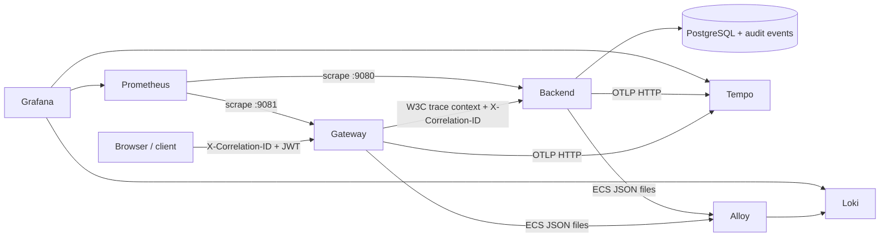

# Arquitectura de observabilidad

## Decisiones

- Spring Boot genera JSON ECS; no existe encoder artesanal.
- Los logs se rotan a 10 MB, siete archivos y máximo 100 MB por servicio.
- Alloy lee volúmenes en solo lectura; no monta Docker socket.
- Management usa puertos internos separados para no publicar Prometheus en el
  Gateway.
- Sampling predeterminado: 10 %, configurable mediante
  `OBSERVABILITY_TRACING_SAMPLING_PROBABILITY`; local puede usar `1.0`.
- Propagación distribuida usa Micrometer Tracing/OpenTelemetry y W3C context.
- Prometheus conserva siete días/1 GB; Loki y Tempo, siete días.
- Grafana se provisiona desde archivos y no permite signup/anonymous access.

## Auditoría

`users` consume `observability::api`. El use case valida una allowlist de
metadata, obtiene correlation ID mediante un output port y usa un adapter JDBC
de solo inserción. Las operaciones locales transaccionales insertan el evento
en la misma transacción. Invitaciones involucran Auth0: su evento se inserta
después del efecto externo y un fallo se eleva y contabiliza para reconciliación.
