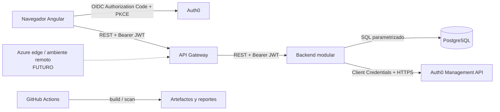

# Modelo de amenazas de MyComplex

Fecha de evaluación: 30 de octubre de 2026. Método: STRIDE con valoración
cualitativa de probabilidad e impacto. El alcance representa el sistema actual;
los servicios cloud todavía no desplegados aparecen solo como mitigaciones
futuras.

## Sistema, actores y activos

Actores legítimos: administrador, residente/propietario, trabajador y futuro
personal de vigilancia, cada uno limitado por su rol y copropiedad. Actores de
amenaza: usuario autenticado malicioso, atacante anónimo, dependencia
comprometida y operador con privilegios indebidos.

Activos principales:

- Identidades Auth0, JWT y credenciales M2M.
- Datos personales y documentos de usuarios.
- Membresías, roles, estados y asignaciones residenciales.
- Estructuras y unidades de cada copropiedad.
- Integridad de PostgreSQL y trazabilidad administrativa.
- Código, workflow de CI, imágenes y SBOM.
- Disponibilidad del Gateway, backend y proveedores externos.

## Flujo y límites de confianza

Los límites son navegador/Internet, Gateway/backend, backend/base de datos,
backend/Auth0 y repositorio/runner CI. PostgreSQL no es una interfaz pública.

## Escala

- Probabilidad: Baja, Media, Alta.
- Impacto: Bajo, Medio, Alto.
- Riesgo: Bajo, Medio, Alto o Crítico. No se confirmó un riesgo Crítico.
- Residual: riesgo que permanece con los controles actuales.

## Catálogo STRIDE

| ID | STRIDE | Escenario, activo y actor | Vector | Prob. / impacto / riesgo | Controles actuales | Mitigación pendiente y residual | Evidencia / responsable sugerido |
|---|---|---|---|---|---|---|---|
| TM-S-01 | Spoofing | Atacante suplanta a un usuario mediante JWT falsificado | Token alterado, issuer o audience incorrectos | Baja / Alto / Medio | Resource Server valida JWT en Gateway y backend | Verificar configuración real por ambiente y rotación; residual Bajo | Security configurations y `application.properties` / Backend-DevOps |
| TM-S-02 | Spoofing | Robo y reutilización de Bearer token | XSS, equipo comprometido o fuga de logs | Media / Alto / Alto | Auth0 SDK; tokens no se imprimen deliberadamente; CI busca secretos | CSP y headers verificados en despliegue, vida útil/rotación del tenant, respuesta a incidentes; residual Medio | frontend `app.config.ts`, CI / Frontend-Security |
| TM-S-03 | Spoofing | Backend usa una identidad Auth0 ajena al usuario local | Coincidencia insegura por correo | Baja / Alto / Medio | Búsqueda exacta, conexión esperada y `app_metadata.mycomplexUserId` | Monitorear conflictos y revisar scopes M2M; residual Bajo | `Auth0ExternalIdentityAdapter`, `InvitePropertyMemberServiceTest` / Backend |
| TM-T-01 | Tampering | Modificación concurrente sobrescribe membresía o asignaciones | Request con versión obsoleta | Baja / Alto / Medio | `@Version`, locks, transacciones y rechazo de stale version | Mantener pruebas al ampliar operaciones; residual Bajo | persistence adapters e integration tests / Backend |
| TM-T-02 | Tampering | Inyección altera o extrae datos | Campos REST o identificadores manipulados | Baja / Alto / Medio | Bean Validation y consultas JDBC/JPA parametrizadas | SAST/DAST continuos; residual Bajo | DTO, adapters, CodeQL / Backend |
| TM-T-03 | Tampering | Supply chain o workflow comprometido modifica artefactos | Dependencia o GitHub Action maliciosa | Media / Alto / Alto | Dependabot, CodeQL, Gitleaks, Trivy, SBOM, revisión de PR | Evaluar pin por SHA y protección de ramas; residual Medio | `.github/workflows/ci.yml`, Dependabot / DevOps |
| TM-T-04 | Tampering | Cliente intenta mass assignment sobre una membresía; activo: roles/estados; actor: usuario autenticado | Campos imprevistos o binding directo de entidad | Baja / Alto / Medio | DTO request explícitos y mapeo controlado | Revisar allowlist al ampliar contratos; residual Bajo | controllers/DTO de `users` / Backend |
| TM-T-05 | Tampering | Se versiona un secreto; activos: credenciales/JWT; actor: tercero con acceso al historial | Commit accidental o log CI | Media / Alto / Alto | Gitleaks sobre historial, secretos externos y reportes redactados | Secret scanning remoto, rotación y runbook; residual Medio | E-14 / DevOps-Security |
| TM-T-06 | Tampering | Imagen o workflow manipulado genera artefacto no confiable; actor: dependencia/colaborador comprometido | Base image, Action o workflow alterado | Media / Alto / Alto | Lockfiles, Trivy de imágenes, CodeQL, SBOM y revisión | Pinning/provenance y branch protection; residual Medio | E-14 / DevOps-Maintainers |
| TM-T-07 | Tampering | Se asigna una unidad residencial ajena o se manipula la principal; actor: admin/cliente alterado | UUID foráneo, duplicado o múltiples principales | Baja / Alto / Medio | Scope por `propertyId`, validación, constraints y transacción | Mantener invariant en nuevas operaciones; residual Bajo | E-06, E-10, E-11 / Backend |
| TM-R-01 | Repudiation | Administrador niega cambio de rol, desvinculación o invitación | Evento omitido o almacenamiento de auditoría no disponible | Media / Alto / Alto | Auditoría append-only, correlation ID, timestamp UTC, métricas y alertas locales | Restringir acceso, operar retención y notificaciones en ambiente remoto; residual Medio | E-17 / Backend-Security |
| TM-I-01 | Information Disclosure | Error REST revela stack trace, SQL, token o secreto; actor: atacante remoto | Excepción inesperada | Baja / Alto / Medio | Handler usa códigos, mensaje genérico y correlation ID sin exponer el stack | Verificar configuración y respuestas en ambiente remoto; residual Bajo | E-09, E-17 / Backend |
| TM-I-02 | Information Disclosure | Usuario accede a miembros de otra copropiedad (IDOR) | Cambiar `propertyId` o `membershipId` | Baja / Alto / Medio | Autorización en servicio y consultas acotadas por propiedad | Conservar pruebas negativas en cada endpoint nuevo; residual Bajo | service/repository tests / Backend |
| TM-I-03 | Information Disclosure | Endpoint operativo expone configuración o salud sensible | Actuator o error público | Baja / Medio / Bajo | Actuator usa puerto de gestión interno; detalles restringidos o deshabilitados y Prometheus no se enruta por Gateway | Restringir la red de gestión en el despliegue; residual Bajo | backend/gateway `application.properties`, `compose.yaml` / DevOps |
| TM-I-04 | Information Disclosure | Datos sensibles llegan a logs o artefactos CI | Logging de request/token o reporte publicado | Media / Alto / Alto | Redacción de Gitleaks y artefactos limitados; no se observa logging de tokens | Política de clasificación, masking y retención antes de auditoría; residual Medio | CI y Auth0 adapter / DevOps-Security |
| TM-D-01 | Denial of Service | Automatización satura APIs o PostgreSQL | Requests repetidos a endpoints autenticados | Alta / Medio / Alto | Timeouts de integración y límites de pools/framework | Rate limiting/WAF administrado y métricas; residual Alto | no existe limiter general; WAF propuesto / DevOps |
| TM-D-02 | Denial of Service | Invitaciones repetidas agotan cuota Auth0 o correo | Abuso de invite/resend | Media / Medio / Medio | Cooldown, máquina de estados, idempotencia y manejo 429 | Límite de borde por identidad/ruta y alerta; residual Medio | invitation adapter/tests / Backend-DevOps |
| TM-D-03 | Denial of Service | Auth0 no disponible bloquea login o provisión | Timeout, 429 o caída externa | Media / Alto / Alto | Timeouts, cache de token M2M, estados recuperables y errores seguros | Runbook, métricas, retry acotado/circuit breaker evaluado; residual Medio | Auth0 adapter e invitation service / Backend-Operations |
| TM-E-01 | Elevation of Privilege | Miembro no administrador ejecuta operación administrativa | Manipular rol en cliente o llamar API directa | Baja / Alto / Medio | Rol se obtiene en DB, autorización en aplicación y revalidación transaccional | Centralizar política al crecer módulos y auditar denegaciones; residual Bajo | services, persistence adapters, tests / Backend |
| TM-E-02 | Elevation of Privilege | Se elimina/degrada el último administrador y se toma control operativo | Carrera entre requests | Baja / Alto / Medio | Lock de propiedad, conteo dentro de transacción y protección explícita | Mantener invariant en todos los casos futuros; residual Bajo | management adapters/integration tests / Backend |
| TM-E-03 | Elevation of Privilege | Cliente M2M Auth0 posee scopes excesivos | Secreto filtrado o permisos amplios | Media / Alto / Alto | Secreto externo al código; llamada solo desde backend | Inventariar scopes mínimos, rotación y segregación por ambiente; residual Medio | configuración externa no verificable / Auth0 owner-Security |

### Activo y actor por amenaza

Esta tabla hace explícitos los dos campos que en el catálogo se resumen dentro
del escenario.

| IDs | Activo protegido | Actor de amenaza |
|---|---|---|
| TM-S-01 | Identidad, JWT y sesión | Atacante anónimo |
| TM-S-02 | JWT y datos de la cuenta | Atacante con acceso al navegador, dispositivo o logs |
| TM-S-03 | Identidad Auth0 y usuario local | Usuario externo o identidad previamente registrada |
| TM-T-01, TM-E-02 | Membresía, rol y asignaciones | Administrador concurrente o cliente alterado |
| TM-T-02 | PostgreSQL y datos personales | Atacante remoto, autenticado o anónimo según ruta |
| TM-T-03, TM-T-06 | Código, workflow, imagen y artefactos | Dependencia o colaborador comprometido |
| TM-T-04 | Campos de usuario/membresía | Usuario autenticado que altera el request |
| TM-T-05 | Secretos y configuración | Colaborador accidental o tercero con historial |
| TM-T-07 | Unidad y relación residencial | Administrador malicioso o cliente alterado |
| TM-R-01 | Trazabilidad y evidencia | Administrador que ejecutó una acción sensible |
| TM-I-01 | Configuración, SQL, tokens y PII | Atacante remoto que provoca errores |
| TM-I-02 | Miembros y PII de otra copropiedad | Usuario autenticado de otro tenant |
| TM-I-03 | Configuración operativa | Atacante anónimo |
| TM-I-04 | Logs, reportes y datos sensibles | Operador, colaborador o tercero con acceso a artefactos |
| TM-D-01 | Disponibilidad de API y PostgreSQL | Bot o usuario abusivo |
| TM-D-02 | Cuotas Auth0/correo e invitaciones | Administrador comprometido o automatización |
| TM-D-03 | Login y aprovisionamiento | Falla o throttling del proveedor externo |
| TM-E-01 | Roles, membresías y datos tenant | Miembro no administrador |
| TM-E-03 | Tenant Auth0 e identidades | Atacante con Client Secret o cliente sobredimensionado |

## Decisiones derivadas

1. La trazabilidad de operaciones sensibles (TM-R-01) ya tiene una línea base
   local; la siguiente prioridad es operar sus alertas y el control antiabuso
   en el borde (TM-D-01/TM-D-02).
2. La validación doble de JWT se conserva: el Gateway reduce superficie y el
   backend sigue siendo el punto de decisión de negocio.
3. El identificador de copropiedad siempre se trata como dato no confiable; no
   constituye autorización por sí mismo.
4. Auth0, PostgreSQL y GitHub Actions son dependencias confiables solo después
   de autenticación, configuración mínima y validación de sus respuestas.
5. La observabilidad local usa Prometheus, Grafana, Loki, Tempo y Alloy sin
   introducir bus de eventos; la auditoría cruza un puerto de aplicación y un
   adaptador PostgreSQL append-only.

## Límites de la evaluación

Es una revisión estática y documental. No se inspeccionaron secretos, tenant
Auth0 real, red cloud ni base de datos de producción; no se ejecutaron ataques,
DAST ni pruebas de carga. La probabilidad debe revisarse con telemetría real.
