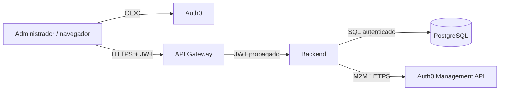

# Zero Trust en MyComplex

Estado: aplicación parcial del modelo; controles de despliegue pendientes.

Zero Trust se interpreta como **verificar explícitamente**, **usar el menor
privilegio** y **asumir una posible vulneración**. No se presenta como una
tecnología ni como una certificación.

## Límites de confianza

Cada flecha cruza un límite. La identidad del navegador no se confía por haber
pasado por el Gateway: el backend valida de nuevo el token y el servicio de
aplicación comprueba el rol activo dentro de la copropiedad solicitada.

## Verificar explícitamente

| Control | Estado | Evidencia |
|---|---|---|
| Firma, issuer y audience del JWT | VERIFICADO | `UserSecurityConfiguration`, gateway `SecurityConfiguration` y `application.yml` de ambos componentes |
| Autorización administrativa por operación | VERIFICADO | `FindPropertyMembersService` y servicios de gestión/invitación |
| Aislamiento por `propertyId` | VERIFICADO | repositorios y adapters con consultas acotadas; `UserPropertyJpaRepositoryTest` |
| Revalidación dentro de la transacción | VERIFICADO | `PropertyMemberUpdatePersistenceAdapter` y `PropertyMemberManagementPersistenceAdapter` |
| Origen CORS allowlisted | VERIFICADO localmente | configuración del Gateway; requiere valor por ambiente en producción |
| Identidad M2M hacia Auth0 | VERIFICADO en código | `Auth0ExternalIdentityAdapter`; credenciales reales fuera del repositorio |

## Menor privilegio

- El frontend usa un cliente público y no posee el Client Secret M2M.
- Solo el backend consume Auth0 Management API.
- Las operaciones administrativas exigen membresía activa con
  `PROPERTY_ADMIN`; no basta un rol enviado por el cliente.
- Los DTO REST exponen campos permitidos y evitan enlazar directamente entidades
  persistentes.
- Actuator publica únicamente `health` e `info`; el Gateway no revela detalles.

Pendiente: documentar y verificar los scopes mínimos del cliente M2M, los
privilegios mínimos del usuario PostgreSQL y la segregación de identidades por
ambiente cuando exista infraestructura cloud.

La configuración obtiene credenciales fuera del código, pero el repositorio no
demuestra mínimo privilegio del usuario PostgreSQL. Para el futuro Azure se debe
evaluar Azure Key Vault y, donde el servicio elegido lo soporte, Managed
Identity u OIDC de corta duración en vez de secretos estáticos. Es una decisión
pendiente, no un control implementado.

## Asumir vulneración

Controles presentes:

- Correlation ID validado como UUID en el Gateway.
- Estado durable e idempotente para aprovisionamiento e invitación.
- Optimistic locking, locks pesimistas y rollback transaccional.
- Mensajes REST seguros para errores de negocio e integración.
- Gitleaks, Trivy, CodeQL, Dependabot y SBOM en CI.

Brechas:

- La auditoría durable cubre las operaciones administrativas actuales de
  `users`; otros módulos futuros deberán incorporarse explícitamente.
- Las alertas locales detectan denegaciones repetidas, pero no existe todavía
  Alertmanager ni receptor operado.
- No hay rate limiting general en el borde.
- No están definidos retención, integridad y acceso a logs de producción.
- El despliegue HTTPS, HSTS, segmentación y gestión de secretos aún no existe.
- PostgreSQL y backend todavía no tienen segmentación de red cloud verificable.

## Hoja de ruta mínima

1. **Antes del primer ambiente remoto**: TLS extremo a extremo, secretos por
   ambiente, origins CORS exactos, usuario DB de mínimo privilegio y exposición
   privada de PostgreSQL.
2. **Antes de pruebas públicas**: rate limiting administrado en el borde,
   política de WAF en modo detección y verificación de headers HTTP.
3. **Antes de producción**: validar retención y acceso restringido para logs y
   auditoría, operar Alertmanager/receptores y ensayar los runbooks.
4. **Operación continua**: revisar scopes, dependencias, SBOM, hallazgos y
   accesos; revocar credenciales y sesiones ante incidentes.

No se propone service mesh, una red de microservicios ni un motor casero de
rate limiting: no corresponden al monolito modular ni al alcance actual.
